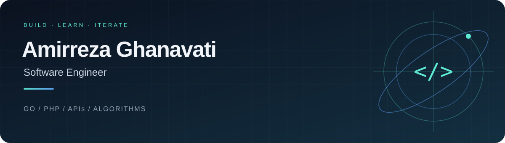

  

  <b>Backend development · Problem solving · Learning in public</b>

  <a href="https://github.com/amirghanavati/golang-web-api">Explore my API project</a> &nbsp; / &nbsp;
  <a href="https://github.com/amirghanavati/leetcode-journey">Follow my learning journey</a>

---

### Hey, I'm Amirreza 👋

I'm a software engineer building APIs in **Go** and sharpening my problem-solving skills with **Go and PHP**. This is where I share what I build, practice, and learn along the way.

- **Building:** a Go web API, with middleware and request validation.
- **Practicing:** data structures, algorithms, and reusable problem-solving patterns.
- **Documenting:** my LeetCode journey in English and Persian.

### Selected work

| Project | What you'll find |
| :--- | :--- |
| **[Go Web API →](https://github.com/amirghanavati/golang-web-api)** | A backend project in Go, exploring API structure, middleware, and request validation. |
| **[LeetCode Journey →](https://github.com/amirghanavati/leetcode-journey)** | Algorithm practice in Go and PHP, with bilingual explanations, a roadmap, and a pattern index. |

### Working with

**Go** &nbsp; · &nbsp; **PHP** &nbsp; · &nbsp; **Git** &nbsp; · &nbsp; **GitHub Actions**

APIs &nbsp; / &nbsp; Data structures &nbsp; / &nbsp; Algorithms

---

<i>Build something. Understand it. Make it better.</i>

سلام، من امیررضا هستم؛ اینجا پروژه‌ها و مسیر یادگیری‌ام را به اشتراک می‌گذارم.

